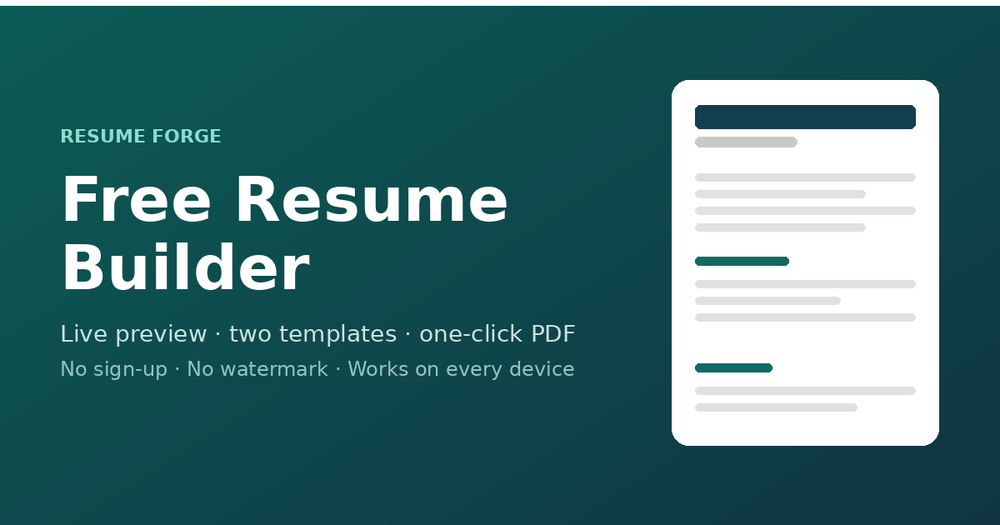

# Resume Builder

A free online resume builder. Fill in your details, pick a template, and download a clean, professional resume as a PDF — right in your browser. No sign-up, no watermark, nothing to install.

**Open the resume builder →** https://theadvay.github.io/resume-builder/

## What you can do

- **Build a resume in minutes.** Type your details on one side and watch your resume take shape on the other, live.
- **Choose from 20 templates.** Classic, Modern, Minimal, Elegant, Compact, Bold, Timeline, Banner, Right Rail, Two Column, Academic, Creative, Corporate, Mono, Infographic, Swiss, Photo Left, Gradient, Dark Sidebar and Spotlight. Switch any time — your content stays.
- **Add your photo.** Upload a profile picture and it appears in the templates that have a photo area.
- **Make it yours.** Pick from eight accent colours and three font styles.
- **Download as PDF.** One click and you have a print-ready A4 resume to attach to any application.
- **Never lose your work.** Everything is saved automatically in your browser, so you can close the tab and come back later.
- **Keep it private.** Nothing you type or upload is ever sent to a server — it all stays on your own device.
- **Use it anywhere.** Works on a phone, tablet, laptop or desktop.

## How to use it

1. Open the resume builder.
2. Fill in your details — name and contact, a short summary, work experience, education, projects, skills and certifications. Add only what you need; empty sections never show up.
3. Pick a template, an accent colour and a font. Upload a photo if you like.
4. Click **Save as PDF**, then choose **Save as PDF** as the destination. Your resume is ready.

## Tips for a resume that gets noticed

- Keep it to one or two pages.
- Start every bullet with an action verb — built, led, shipped, reduced.
- Add numbers wherever you can. “Cut page load from 3s to 800ms” beats “improved performance”.
- Write your summary for the role you want, not the one you have.
- Save the PDF with a clear name, like `Advay-Sharma-Resume.pdf`.

## Questions

**Is it free?**
Yes, completely. No sign-up, no subscription, no watermark on the resume you download.

**Do I need an account?**
No. Just open the site and start typing.

**Can I add my photo?**
Yes. Upload one in the Personal info section. It’s resized on your device and appears in the templates that have a photo area.

**Can I download my resume as a PDF?**
Yes — click Save as PDF and choose “Save as PDF” as the print destination.

**Is my data safe?**
Yes. The builder runs entirely in your browser. Your details never leave your device.

**Will it work on my phone?**
Yes. It adapts to any screen size, and on small screens you can switch between the editor and the preview.

---

Made by [Advay](https://github.com/theadvay).
